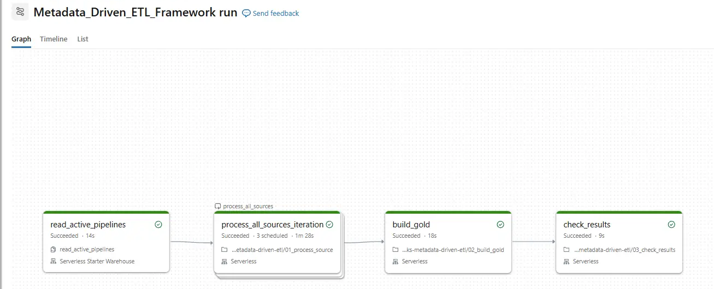
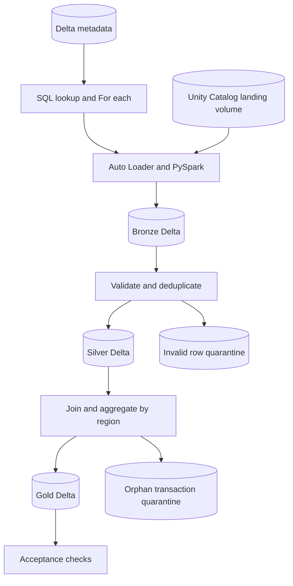
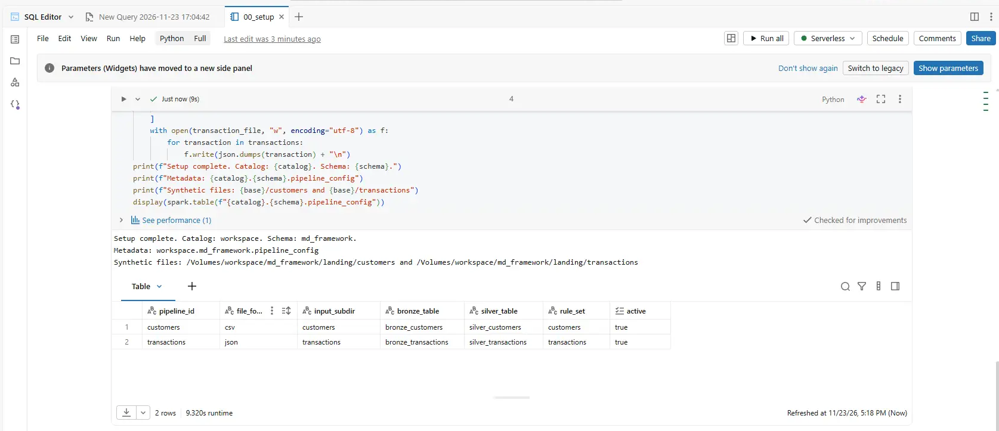
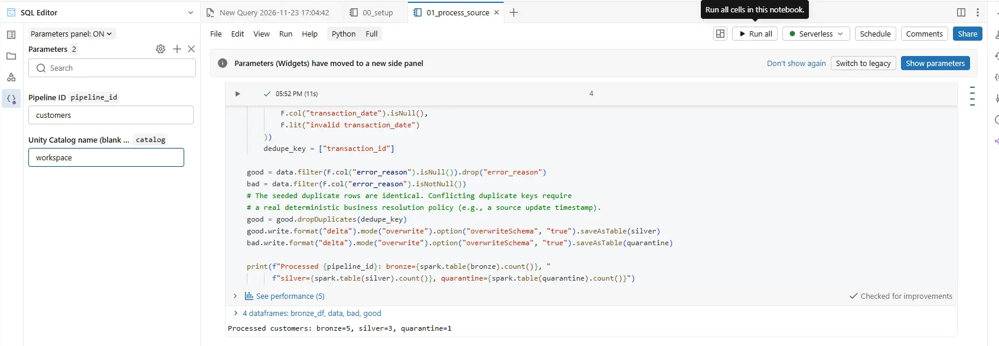
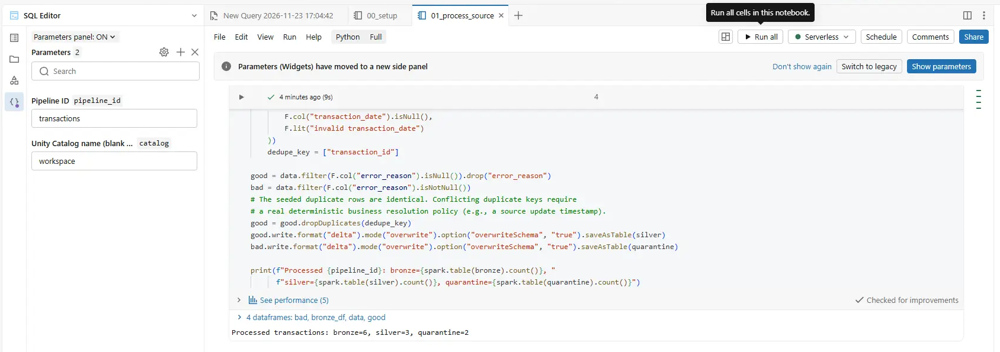
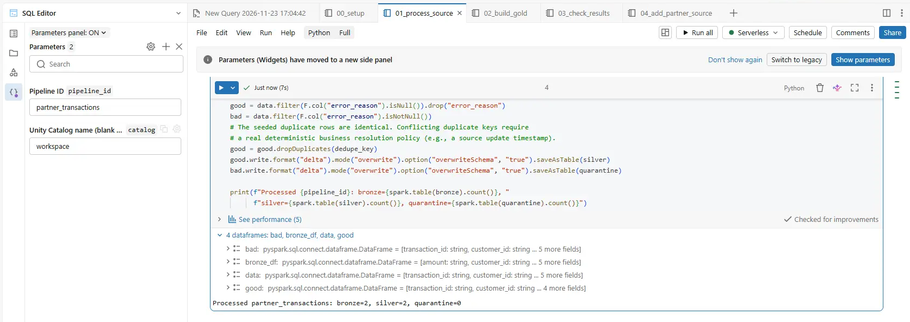
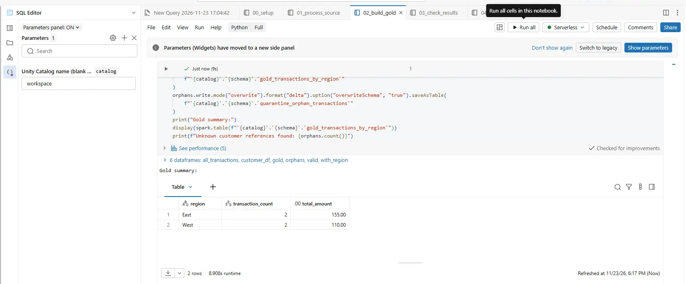
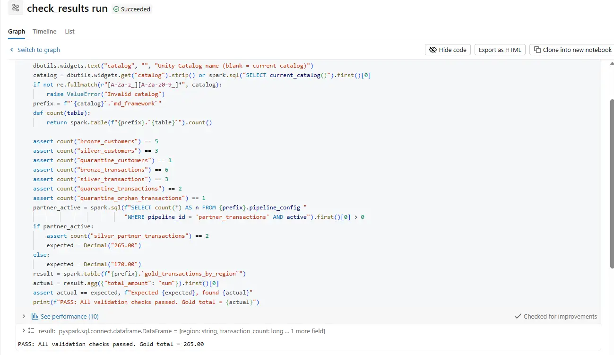

# Databricks Metadata-Driven ETL

A PySpark and Delta Lake pipeline that ingests synthetic customer and transaction feeds, quarantines invalid records, and publishes transaction totals by customer region. A Delta control table drives ingestion. The partner feed was added through configuration and reused the existing processor.

## Validated run

| Metric | Result |
| --- | ---: |
| Data sources integrated | 3 |
| Raw records processed | 13 |
| Observed workflow runtime | 2m 12s |
| Validated Gold total | $265.00 |

Runtime is from one Databricks run on this synthetic dataset. See the [execution evidence index](docs/screenshots/README.md).

## Successful workflow with three source iterations

## Architecture

[Architecture notes](docs/architecture.md)

## Implementation and data quality

- **Ingestion.** Each active `pipeline_config` row selects the file format, landing path, Bronze and Silver tables, and validation rule set. Auto Loader uses an independent schema location and checkpoint per feed and an available-now trigger to process available files. Bronze records retain the source path and ingestion timestamp.
- **Validation.** Silver snapshots apply customer or transaction rules and deduplicate valid records by key. Invalid records retain an error reason. The Gold job joins valid transactions to customers and isolates unmatched customer references before aggregating.
- **Extensibility.** The partner JSON feed uses its own metadata row and targets while reusing the transaction rules.

| Feed | Raw Bronze | Valid Silver after deduplication | Invalid row quarantine |
| --- | ---: | ---: | ---: |
| Customers | 5 | 3 | 1 |
| Transactions | 6 | 3 | 2 |
| Partner transactions | 2 | 2 | 0 |

One $17.00 transaction with an unknown customer remains in the separate orphan quarantine. The two-feed baseline is $170.00. The two partner transactions add $95.00, bringing Gold to $265.00. The [acceptance notebook](notebooks/03_check_results.py) asserts the core table counts, orphan count, partner Silver count when active, and Gold total. The partner ingestion output confirms 2 Bronze rows and 0 quarantined rows.

## Execution screenshots

### Initial customer and transaction configuration

### Customer ingestion — 5 Bronze, 3 Silver, 1 quarantined

### Transaction ingestion — 6 Bronze, 3 Silver, 2 quarantined

### Partner ingestion — 2 Bronze, 2 Silver, 0 quarantined

### Gold summary — East $155.00 and West $110.00

### Passing acceptance checks — $265.00 Gold total

## Reproduce the run

1. Open the repository in a Databricks Git folder or import the Python source files from [`notebooks/`](notebooks/) as notebooks. Use compute with Unity Catalog and Auto Loader support, and a writable catalog with permissions to create the demo schema, volumes, and tables. Use the same `catalog` parameter throughout.
2. Run [`00_setup.py`](notebooks/00_setup.py) to create the control table, landing and state volumes, and the customer CSV and transaction JSON fixtures.
3. Run [`04_add_partner_source.py`](notebooks/04_add_partner_source.py) to seed and register the partner JSON feed. For a two-feed baseline, defer this step until after the first validation.
4. Replace `YOUR_CATALOG` in [`read_active_pipelines.sql`](sql/read_active_pipelines.sql) and save it as a Databricks SQL query. Create a job with a SQL query task named `read_active_pipelines` using that query and a SQL warehouse.
5. Add a dependent **For each** task. Set Inputs to `{{tasks.read_active_pipelines.output.rows}}` and point its nested notebook task to [`01_process_source.py`](notebooks/01_process_source.py). Pass `pipeline_id={{input.pipeline_id}}` and your `catalog`. Alternatively, run the processor manually once for each active source: `customers`, `transactions`, and `partner_transactions`.
6. Run [`02_build_gold.py`](notebooks/02_build_gold.py) after all ingestion iterations, then run [`03_check_results.py`](notebooks/03_check_results.py). Add both as ordered dependent notebook tasks to run the full workflow in one job.
7. Set the same catalog in [`inspect_results.sql`](sql/inspect_results.sql) to inspect metadata, Gold totals, and quarantine tables.

## Design trade-offs

- Bronze ingestion tracks files incrementally. Rebuilding Silver and Gold as snapshots keeps the small fixture easy to reconcile. Larger tables would benefit from incremental Delta merges and explicit backfill handling.
- Transaction IDs are assumed unique across feeds and seeded duplicates are identical. Conflicting records would need a deterministic winner and a cross-source key policy.
- Metadata can onboard feeds using an existing rule set. A new schema requires explicit validation rules.
- The reported run uses synthetic data. Production use would require schema contracts, audit metrics, alerts, and deployment automation.

[MIT License](LICENSE)
