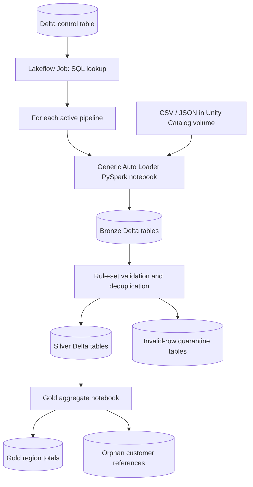

# Project architecture

## Limitations
- Silver and Gold snapshots are overwritten for simplicity; large production workloads should use transactional incremental changes.
- `dropDuplicates` is used only for identical seeded duplicates. Conflicting duplicate records need deterministic precedence.
- The rule-set dispatch is intentionally explicit and supports customer and transaction schemas. New schema types require corresponding rules.
- Config metadata must be restricted to trusted writers; secrets do not belong in control tables.
- No SLA, encryption policy, DR/HA, high-scale benchmarks, or production reliability claims are demonstrated here.
